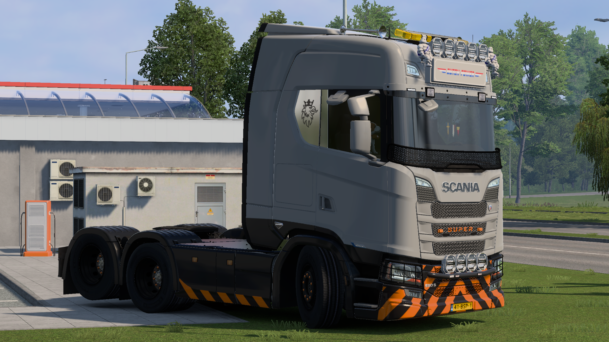

# Construction

Authorized for heavy haulage and oversized freight across all heavy-spec low-loader configurations.

***

## Paintjob: Heavy Duty Construction

> **Type:** Heavy Cargo DLC
> **Applicable To:** All Trucks

### Paint Specifications

| Attribute        | Details |
| ---------------- | ------- |
| **In-Game Name** | Heavy Duty Construction    |
| **Required DLC** | Heavy Cargo DLC    |

### Color Palette

**HEX Codes**

* **Color 1 :** `#919191` _(Broken White)_
* **Color 2 :** `#282828` _(Deep Charcoal)_
* **Color 3 :** `#F37A00` _(NextGear Orange)_
* **Color 4 :** `#919191` _(Broken White)_

**RGB Codes**

* **Color 1 :** `145, 145, 145` _(Broken White)_
* **Color 2 :** `40, 40, 40` _(Deep Charcoal)_
* **Color 3 :** `243, 122, 0` _(NextGear Orange)_
* **Color 4 :** `145, 145, 145` _(Broken White)_


**Important:** Ensure the color slots in the workshop match the exact order listed above to maintain the official NextGear design.

